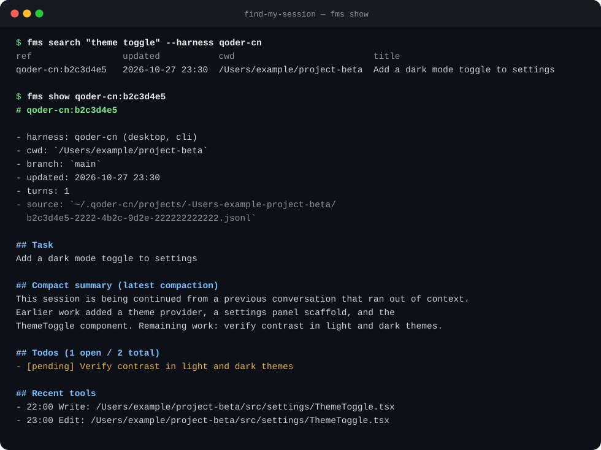
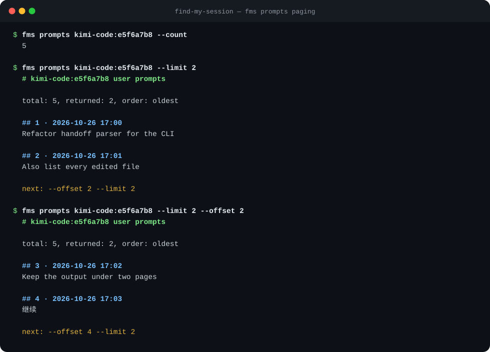
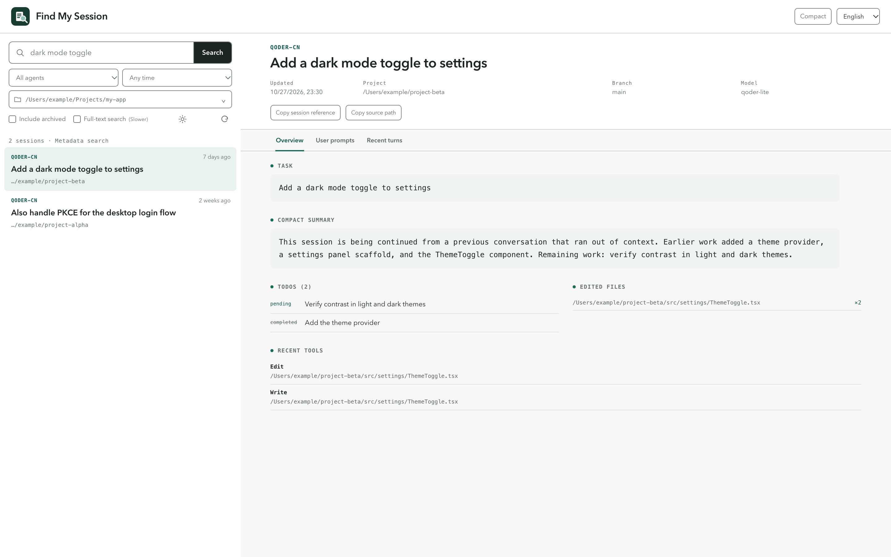

# find-my-session

[](https://github.com/SomeNoneAI/find-my-session/actions/workflows/ci.yml)
[](https://scorecard.dev/viewer.html?url=github.com/SomeNoneAI/find-my-session)
[](https://pypi.org/project/find-my-session/)
[](pyproject.toml)
[](LICENSE)

面向编程 agent 的本地、只读会话查找与接力工具，以两种形态发布，共享同一个 `fms_lib` 核心：

- **find-my-session-skill** —— 面向 agent 的 skill（`fms` CLI）：跨 harness 找到目标会话，输出低 token 的接力摘要，而不是整份 transcript。
- **find-my-session-ui** —— 面向人类的浏览器面板，读取同一批会话存储。

某个 harness 的额度用完后，你通常还记得“在做什么”，却不记得会话存在哪里。`fms` 用一条紧凑命令回答这个问题。







截图使用合成 fixture 数据。

[English README](README.md)

## 支持的 harness

已有十九个可用适配器，另有两个在计划中。实测版本、端与注意事项见[兼容矩阵](docs/compatibility.md)；各 harness 的存储细节见 [references/](skills/find-my-session/references/)。

| Harness | 引用前缀 | 默认目录 |
| --- | --- | --- |
| Qoder CN | `qoder-cn` | `~/.qoder-cn` |
| Qoder（国际版） | `qoder` | `~/.qoder` |
| Kimi Code | `kimi-code` | `~/.kimi-code` |
| ZCode | `zcode` | `~/.zcode` |
| CodeArts Agent | `codearts-agent` | `~/.codeartsdoer` |
| ChatGPT Codex | `codex` | `~/.codex` |
| DeepSeek Harness | `deepseek` | `~/.dsh` |
| Claude Code | `claude-code` | `~/.claude` |
| Cline | `cline` | `~/.cline` |
| Grok Build | `grok-build` | `~/.grok` |
| WorkBuddy AI | `workbuddy` | `~/.workbuddy-ai` |
| WorkBuddy（国内版） | `workbuddy-cn` | `~/.workbuddy` |
| Antigravity | `antigravity` | `~/.gemini/antigravity` |
| Antigravity CLI | `antigravity-cli` | `~/.gemini/antigravity-cli` |
| MiniMax Code | `minimax-code` | `~/.minimax/v2` |
| Cursor | `cursor` | `~/.cursor/projects` |
| OpenCode | `opencode` | `~/.local/share/opencode` |
| Gemini CLI | `gemini-cli` | `~/.gemini` |
| Qwen Code | `qwen` | `~/.qwen` |
| CodeBuddy | `codebuddy`（计划中） | `~/.codebuddy` |
| Cline（VS Code 扩展） | `cline-vscode`（计划中） | VS Code globalStorage |

## 环境要求

- Python 3.9 或更高版本；macOS 或 Linux。Python 3.9 已在上游停止维护，0.2 计划要求 3.10+（见 [ROADMAP.md](ROADMAP.md)）。
- 无第三方 Python 依赖
- 压缩存储（`codex` 的 `.jsonl.zst`、`deepseek` 的 `.zstd`）需要 zstd 解码器：Python 3.14+ 或 `zstd` 命令行；两者都没有时会跳过这些会话
- Windows 有实验性、非阻塞的 CI 任务，但尚不支持；见 [ROADMAP.md](ROADMAP.md)

## 安装

### CLI 与 UI 命令

`pipx install find-my-session` 会从 PyPI 安装 `fms` 与 `fms-ui` 两个命令。若要运行未发布的提交，改用 Git 安装：`pipx install git+https://github.com/SomeNoneAI/find-my-session.git`。用 `pipx upgrade find-my-session` 升级，用 `pipx uninstall find-my-session` 卸载。使用 `uv` 时，`uvx --from find-my-session fms ...` 可以直接运行 PyPI 版本而无需永久安装。

### 面向 agent：skill

1. **Release ZIP**：每个 GitHub Release 会发布 `find-my-session-skill.zip`。从 [latest release](https://github.com/SomeNoneAI/find-my-session/releases/latest) 下载后安装到你的 harness（例如在 Qoder 桌面端通过 **扩展 → 技能** 上传，或解压后链接到 harness 的 skills 目录）。
2. **源码检出**：

   ```bash
   git clone https://github.com/SomeNoneAI/find-my-session.git
   cd find-my-session
   qoderclicn skills link "$PWD/skills/find-my-session"   # Qoder CN CLI；Claude Code：软链到 ~/.claude/skills
   ```

   检出后也可以直接运行 `python3 skills/find-my-session/scripts/fms`，或运行 `python3 tools/build_artifacts.py` 自行构建 `dist/find-my-session-skill.zip`。删除 harness skills 目录中的软链即可卸载链接安装的 skill。

### 面向人类：UI 面板

1. **Release ZIP**：从 [latest release](https://github.com/SomeNoneAI/find-my-session/releases/latest) 下载 `find-my-session-ui.zip`，解压后在目录中运行 `python3 fms-ui`（若解压工具保留执行权限，也可运行 `./fms-ui`）。替换该目录即可升级，删除即可卸载。
2. **pipx**：上面的 pipx 安装同样提供 `fms-ui` 命令。
3. **源码检出**：直接运行 `fms_ui/fms-ui`（用 `--no-browser --port 8765` 可指定端口且不自动打开浏览器）。

面板会在 `127.0.0.1` 启动只读服务，提供关键词与元数据筛选、会话概览、用户输入分页、最近对话和可复制的会话引用。静态前端只走同源 JSON API，不需要 Node.js 或任何外部资源。界面默认跟随本机语言，也可显式切换中/英文；主题默认跟随系统浅色/深色偏好，也可手动切换，深色使用非纯黑配色。前端使用 Vue 3 + TypeScript + Vite 构建；Node.js 仅在开发 `fms_ui/frontend/` 源码时需要，运行面板本身不需要。

## 快速开始

```bash
fms harnesses                                   # 列出可用与计划中的 harness
fms search "额度 接力" --harness kimi-code        # 按关键字查找会话
fms latest --harness kimi-code --cwd .          # 当前仓库最近一次的会话
fms show kimi-code:e5f6a7b8                     # 低 token 接力摘要
fms prompts kimi-code:e5f6a7b8 --count          # 先统计用户输入，再用 --limit/--offset 分页
fms resume claude-code:e1a2b3c4 --exec          # 直接跳回某个会话
fms stats --since 7d                            # 跨 harness 的 token/费用汇总
```

搜索建议显式指定 `--harness`；省略 query 即列出最近会话。归档会话默认不参与 `search`/`latest`，除非传入 `--include-archived`。`show` 全程只读，并会输出原始文件路径；摘要不够时，agent 可以再去 grep 原文件。

## 命令

| 命令 | 用途 |
| --- | --- |
| `fms harnesses` | 列出可用、计划中的 harness、形态和目录。 |
| `fms search [query ...]` | 按关键字搜索会话元数据；省略 query 即列出最近会话。 |
| `fms latest` | 返回最近一个匹配会话。 |
| `fms show <ref>` | 输出单个会话的接力摘要。 |
| `fms prompts <ref>` | 列出单个会话的全部用户输入，支持计数、分页与排序。 |
| `fms stats [--harness] [--since] [--json]` | 汇总各 harness 自身记录的 token/费用；未记录 usage 的显示 `-`。 |
| `fms resume <ref> [--exec]` | 输出（用 `--exec` 则直接运行）在该 harness 中重新打开此会话的命令；未验证续接命令时回退为接力摘要。 |
| `fms doctor [--harness] [--json] [--fingerprint]` | 检查本地环境与存储（解码器可用性、目录可读性、各 harness 健康状况）；`--fingerprint` 额外输出不含内容的存储形态摘要，便于上报格式漂移。 |

## 常用选项

| 选项 | 适用命令 | 含义 |
| --- | --- | --- |
| `--harness NAME[,NAME]` | search, latest, show, prompts, doctor | 限定 harness，推荐用于提速和减少误匹配。 |
| `--cwd PATH` | search, latest | 匹配工作目录与 PATH 相同、包含或被包含的会话。 |
| `--since 7d` / `--since 2026-10-01` | search, latest | 按最后更新时间过滤。 |
| `--limit N` | search, latest, prompts | 限制结果或用户输入条数；`0` 表示不限。 |
| `--offset N` | prompts | 跳过前 N 条用户输入。 |
| `--order oldest/newest` | prompts | 分页顺序；条目仍保留原始时间序号。 |
| `--count` | prompts | 只输出用户输入总数。 |
| `--deep` | search, latest | 额外扫描完整 transcript；更慢，输出仍只有元数据。 |
| `--include-archived` | search, latest | 纳入归档会话。默认关闭。 |
| `--verbose` | search, latest | 在 stderr 警告被跳过的会话，不改变 stdout。 |
| `--messages N` / `--chars N` / `--summary-chars N` | show | 限制对话轮数、单条字符数与摘要字符数。 |
| `--json` | harnesses, search, latest, prompts, doctor | 结构化输出；`show` 使用 `--format json`。字段约定见 [docs/json-output.md](docs/json-output.md)。 |

会话引用格式为 `harness:session-prefix`（例如 `kimi-code:e5f6a7b8`）；也接受受支持 harness 下的原始 transcript 路径。

### 用 fzf 交互选择

所有列表都是纯 TSV，接一条管道即可交互操作：

```bash
fms search --limit 0 | fzf | cut -f1 | xargs -I{} fms show {}
fms search --limit 0 --include-archived | fzf --with-nth=2,4 | cut -f1 | xargs -I{} fms resume {}
```

第二条命令会把选中的会话直接在其原 harness 中续接（需该 harness 有已验证的续接命令，见 `fms resume --help`）。共用同一存储的桌面端与 CLI 属于同一个引用空间，哪些端已实测见[兼容矩阵](docs/compatibility.md)。

## 隐私与安全

- 全部在本地运行，CLI 不发起任何网络请求。
- CLI 只读取会话文件与数据库，并以只读方式打开 SQLite 存储，绝不修改或删除会话内容。
- 搜索结果只含元数据；`show` 与 `prompts` 可能打印会话内容，请把输出与原始 transcript 同等对待。

## 开发与文档

- [CONTRIBUTING.md](CONTRIBUTING.md) —— 环境搭建、测试，以及如何新增或实测一个 harness。
- [docs/compatibility.md](docs/compatibility.md) —— 详细的逐 harness 兼容矩阵。
- [docs/json-output.md](docs/json-output.md) —— `--json` 字段约定与 1.0 前的稳定性策略。
- [ROADMAP.md](ROADMAP.md) —— 近期计划。
- [SECURITY.md](SECURITY.md) —— 支持版本与私密漏洞上报。
- [skills/find-my-session/references/](skills/find-my-session/references/) —— 各 harness 的存储 schema 与验证方法；新增 harness 请先读 [extending.md](skills/find-my-session/references/extending.md)。

```bash
python3 -m unittest discover -s tests -v
python3 -m compileall -q core fms_ui skills/find-my-session/scripts tools tests
python3 tools/build_artifacts.py   # 重新构建 dist/find-my-session-skill(.zip) 与 dist/find-my-session-ui(.zip)
```

## 许可证

MIT，见 [LICENSE](LICENSE)。
